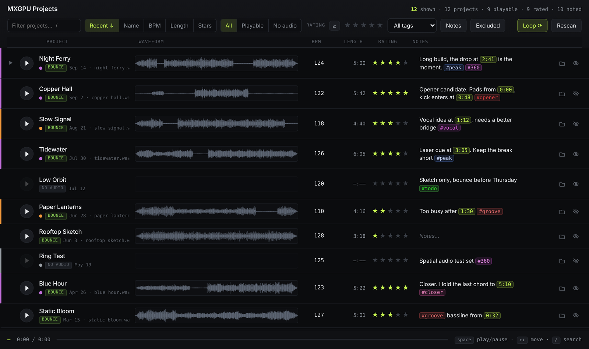
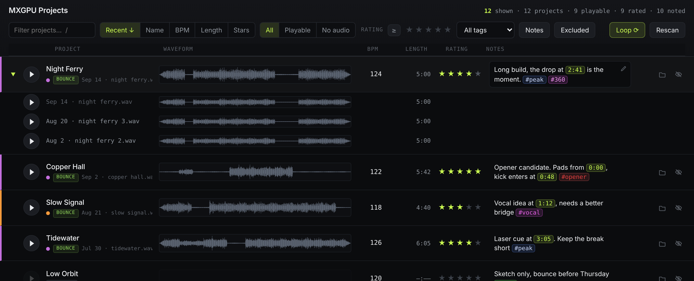

# Ableton Organizer

A browser overview of a folder of Ableton projects: one row per project folder,
with inline looping playback, the BPM from the `.als`, a rating and a notes
field.

Built for [MXGPU](https://www.mxgpu.net), the immersive 360° live show by Moullinex
and GPU Panic. It runs as studio.mxgpu.net and keeps the duo's library of Ableton
projects on one page. More in [Every project on one page](https://www.mxgpu.net/blog/studio-mxgpu-net).





*Screenshots use a demo library; the project names, notes and audio are invented.*

## Run

```sh
python3 organizer.py                    # defaults to $ORGANIZER_ROOT, else ~/Music/Ableton Projects
python3 organizer.py "/path/to/folder"  # any folder of project folders
python3 organizer.py --port 9000 --no-open
python3 organizer.py --ignore "some folder"  # skip a container folder
```

Opens <http://127.0.0.1:8765/>. Python 3 only — no dependencies, no install.

## Password

```sh
python3 organizer.py --password-file ~/.config/ableton-organizer/password --lan
```

Without it nothing is protected, which is fine on your own machine and on a
trusted LAN. **Set it before the app is reachable from anywhere else** — there
is no other thing standing between a stranger and your unreleased bounces.

The password is read from the first line of that file (or `$ORGANIZER_PASSWORD`),
never stored in the repo, and must be at least 8 characters. Everything is
gated: the page, the API, the audio streams and the waveforms all return 401
until you have logged in, and the login page itself contains none of the app.

Sessions are a signed cookie — `HttpOnly`, `SameSite=Lax`, `Secure` over HTTPS —
valid for 14 days. The signing key is derived from the password, so changing the
password logs everyone out. Eight wrong guesses from one address buys a
15-minute lockout; behind a tunnel the real client address is read from
`CF-Connecting-IP` for that count, never for deciding access.

**Opening a project in Ableton was removed.** It launched an app on the host,
which is indefensible once the thing is on the internet. Revealing in Finder
survives but only answers requests from the machine itself; from anywhere else
it is a 403.

## HTTPS

```sh
python3 organizer.py --cert cert.pem --key key.pem --lan
```

Both flags are required together and are checked before the scan, so a wrong
path fails immediately. The port then speaks TLS only — plain http to it is
refused.

On a [Tailscale](https://tailscale.com) machine you can get a real Let's
Encrypt certificate for its tailnet name, so it validates with no browser
warning. This needs **HTTPS Certificates** enabled in the Tailscale admin
console (<https://login.tailscale.com/admin/dns>); without it `tailscale cert`
answers `your Tailscale account does not support getting TLS certs`.

```sh
tailscale cert --cert-file ts-cert.pem --key-file ts-key.pem <machine>.<tailnet>.ts.net
```

Certs live in `~/.config/ableton-organizer/` and last 90 days.
`com.ekkolabs.ableton-organizer-cert` re-runs the command daily — a no-op until
the cert is near expiry — and kickstarts the server only when the file actually
changes, so HTTPS never lapses silently.

The cert is issued for the Tailscale name only. Reaching it by LAN IP or
`<machine>.local` will warn, because those aren't on the certificate.

*Testing tip: verify with `curl` **without** `-k`. `-k` disables the
certificate validation a browser performs, so it reports success against a cert
no browser will accept.*

## Running as a service

`launchd/com.ekkolabs.ableton-organizer.plist` is a template LaunchAgent.
Replace the `/Users/YOU/...` paths (and the hostname in the `-cert` one), then:

```sh
cp launchd/com.ekkolabs.ableton-organizer.plist ~/Library/LaunchAgents/
launchctl bootstrap gui/$(id -u) ~/Library/LaunchAgents/com.ekkolabs.ableton-organizer.plist
launchctl print  gui/$(id -u)/com.ekkolabs.ableton-organizer   # state, pid, exit code
launchctl bootout gui/$(id -u)/com.ekkolabs.ableton-organizer  # stop and uninstall
```

`KeepAlive` restarts it if it dies; `--wait-for-root 300` covers the sync client
not having mounted yet at login. Logs go to
`~/Library/Logs/ableton-organizer.log`.

It's a LaunchAgent, so it starts at **login**, not at boot. With auto-login a
reboot brings it back on its own; without it, it waits until someone signs in.

## From another machine on the network

```sh
python3 organizer.py --lan
```

Binds every interface instead of just localhost and prints the address to use,
e.g. `http://<your-mac>.local:8765/` (or the LAN IP if mDNS is being unhelpful).

Built for a desktop-sized window — the row needs about 830px before it starts
overflowing sideways.

macOS may ask to allow incoming or local-network connections the first time.

**Without `--password-file` there is no password.** Anyone on the network can
read your bounces and edit notes. Fine on a home network, not on cafe or venue
wifi. Leave the flag off and it stays localhost-only.

## What each row shows

| | |
|---|---|
| **Waveform** | Click anywhere to seek. Loops by default; turn `Loop ⟳` off and playback runs on to the next project instead. |
| **BPM** | Read automatically from the project's newest `.als`. Type over it to override; the original stays visible on hover. |
| **Notes** | Multi-line, read-only until you edit. Times like `2:21` become clickable chips that jump the player there. |
| **Rating** | Five stars, 0-5. Click a star to set it; click the same star again to clear back to none. |
| **🗀 / 👁** | Reveal the audio in Finder (only from the machine itself) · exclude from the list. |

## Notes and timestamps

Notes render read-only, so a row stays scannable and a stray click can't
edit it. Any time written as `m:ss`, `mm:ss` or `h:mm:ss` is picked out and
turned into a chip — clicking one loads that project and seeks exactly there:

```
intro too long — cut to 0:08
that filter sweep at 0:19 is the hook
```

A timestamp past the end of the bounce is greyed out and inert, rather than
seeking somewhere that doesn't exist.

**`#hashtags`** are decorated too, each in its own colour. Click one to filter
the list to it, click it again to clear. The **All tags** dropdown lists every tag in use with a
count, so you don't have to remember what you've used. Tags are just text in the
note — there's no separate tag store to keep in sync, and deleting the last use
of a tag removes it from the dropdown by itself.

Colour comes from a hash of the tag name, so a tag looks the same in every row
and on every machine with nothing stored anywhere. Hashing alone collides too
often to be useful — five tags share a colour about half the time — so the
assignment is resolved against the list of tags actually in use: a tag keeps its
hashed colour unless another tag already took it, then it takes the next free
one. That gives 36 distinct colours (12 hues x 3 lightnesses), enough that every
tag differs until you pass 36 of them. Lightness is corrected per hue, because
blue and violet are intrinsically dark and fell below 4.5:1 on a flat scale;
every colour now clears WCAG AA against the row. The band around the accent
green is skipped so a tag never reads as a timestamp.

**To edit**, click the pencil (it appears on hover) or double-click the note.
That opens a multi-line editor with an **⧗ insert time** button which drops the
playhead's current position in at the cursor — so you can play a track, hear
something, and note it at the right second without pausing. `⌘↵` saves, `esc`
discards, clicking away saves.

Timestamps are matched at render time, not stored separately: the note is plain
text, so it stays readable and editable as text.

## Excluding projects

The eye icon on a row drops it from the list — for dead ends, duplicates and
sketches you don't want to scroll past. Nothing is deleted or moved; only a flag
in `data/meta.json` changes.

**Excluded (n)** in the header shows what you've hidden, dimmed and struck
through. The same eye icon there puts a project back. Excluded projects are left
out of the `projects` / `playable` / `noted` counts.

This is the per-project version of `--ignore`, which is still the right tool for
a whole container folder like `archive/`.

Keyboard: `space` play/pause · `↑ ↓` move between rows · `/` focus search.

## Continuous play

With `Loop ⟳` off, a finished bounce hands over to the next project **in the
view you are looking at** — the current filter and sort order, not the whole
library. So filtering to `#groove` sorted by rating gives you exactly that
playlist. Projects with nothing to play are skipped, and it stops at the end
rather than wrapping.

## Sorting and filtering

**Sort** by Recent, Name, BPM, Length or Stars. Click the active button again to
reverse it; the arrow shows the direction. Projects with no value for the
current key — no tempo, no audio — collect at the bottom in *both* directions,
so reversing never buries the list under blanks.

**Audio** is a three-way filter:

- **All** — everything.
- **Playable** — only projects with a bounce.
- **No audio** — only the ones with nothing to play. This is the working
  list for "what still needs a bounce".

**Rating** filters by stars, the way Premiere does it: click the third star to
see everything rated 3 or better, click it again to clear. The **≥** button
beside it switches to **=**, narrowing that to exactly three — so you can pull
up just your one-star sketches without the better material mixed in. The lit
stars show which mode is active: a run up to the threshold for ≥, a single star
for =. `Has notes` and
`Excluded` stack on top of whichever audio mode and tag are selected, and the
stats line names the active filters so a short list is never a mystery.

Unrated projects count as 0, so sorting by Stars descending puts your best work
on top and everything unrated below it.

**Recent means when the bounce was made**, not the folder's mtime. Dropbox
rewrites folder timestamps in bulk, which flattens the whole library to one date
— a whole library can read as one month even though the work spans years.
The bounce's own `st_birthtime` survives that, so Recent reflects when the work
actually happened.

Projects with no bounce fall back to the folder/`.als` time, which is the only
signal left for them. Each row shows whichever date it was ordered by; hover it
to see which one, in full.

## Which audio gets played

The tag on each row tells you where the audio came from:

1. **`bounce`** — a `.wav` sitting at the project root.
2. **`output`** — a name-matched bounce in `_OUTPUT/` (ignores a trailing version
   number, so `song Project` finds `song3.wav`).
3. **`no audio`** — no bounce exists. The row still takes a BPM and notes.

Bounces only, and two formats are deliberately skipped:

- **`Samples/`** is never a preview source — one-shots and loops, so it produced
  things like a 0.7 s tom hit looping as a "preview".
- **`.m4a`** is ignored everywhere. At project root those are voice memos that
  were sampled into the track, not the bounce.

A project with no bounce is honestly reported as having none; filter to
**Audio → No audio** to see what still needs one.

`Backup/`, `M4L/` and folders starting with `_` are skipped, as is `archive/` —
it's a container holding project folders, not a project itself.

```sh
python3 organizer.py --ignore "old stuff"   # skip another container (repeatable)
python3 organizer.py --no-ignore            # scan everything, archive included
```

## Finder tag colours

Folders tagged in Finder get a coloured stripe down the left edge of the row and
a dot next to the name; hover the dot for the tag name. Tag names are searchable
too — typing `orange` finds them.

Colour comes from the **index** in the `com.apple.metadata:_kMDItemUserTags`
xattr, not the name, because the same colour is named per-language: this folder
carries both `Purple\n3` and `Roxo\n3`, and both render purple.

Tags are read fresh on every scan, so recolouring a folder in Finder and hitting
`Rescan` picks it up. Nothing is ever written back to the xattr.

## Earlier bounces

A project with more than one bounce gets a **triangle** at the left of its row.
Expanding it lists every bounce found for that project, newest first, with its
date, filename, length and waveform — click one to hear it. The version rows
share the row grid, so their waveforms and lengths line up under the ones above. The top entry is
dimmed: it's the bounce the row itself plays.

Bounces are gathered from the project folder and from name-matched files in
`_OUTPUT/`, then ordered by creation date — e.g. `song.wav` (13 Jan) through
`SONG 13.wav` (7 Aug).

Everything audio in the folder is listed rather than filtered. Some of what
turns up is reference material rather than an earlier mix — a YouTube rip, a
voice memo — and no rule separates those from a real bounce reliably, so the
filename and date are shown and the judgement is left to you.

## Cloud-only (online-only) files

On a machine where Dropbox keeps files online-only — macOS flags them
`dataless` — reading one blocks while it downloads. Scanning a library of a few hundred
projects can mean gigabytes of downloads on a machine where almost nothing is local.

So bulk scanning never touches a placeholder. Those rows get a blue **cloud**
badge, no BPM and no waveform, but **pressing play still fetches the file** —
that's one deliberate file, not a silent library-wide download.

```sh
python3 organizer.py --materialize   # read everything, downloading as needed
```

Run that once if you want the full picture on a machine with online-only files,
and expect it to pull however many GB that takes.

## Where your edits live

A hidden `.data/` folder **inside the library** — so Dropbox syncs it and every
machine shares one database:

- `meta.json` — notes, BPM overrides, stars, exclusions, keyed by folder name.
- `cache.json` — BPM per `.als` and duration per bounce.
- `peaks/` — cached waveforms (about 8 KB per track).

Keys are the path *relative to the library root* plus mtime and size, all of
which Dropbox preserves. That's what makes the cache portable: **a machine with
online-only files still shows BPM and waveforms, because it reads what the other
machine computed instead of downloading the audio.** Warm them up with:

```sh
python3 organizer.py --warm    # precompute every waveform, then serve
```

`.data/` is skipped by the scanner (dotfolders are), and nothing is ever written
into the project folders themselves. Rename a project folder and its notes won't
follow it. If the library isn't writable the app falls back to `data/` next to
the code.

`Rescan` picks up new projects and re-reads changed `.als` files.

## How the BPM is read

`.als` files are gzipped XML. The scanner streams the file, finds `<MainTrack>`
(or `<MasterTrack>` on older sets) and takes the first `<Tempo><Manual Value=…>`
after it.

## License

[MIT](LICENSE)
